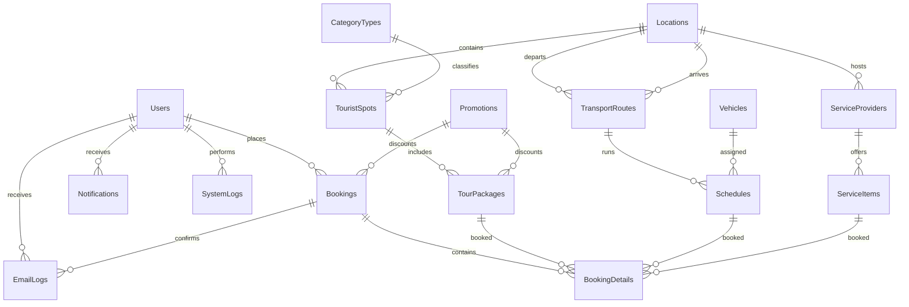

# Entity-relationship diagram

Eighteen tables. A booking line points at one of a tour, a schedule, or a service item.

Contacts and Feedbacks stand alone. They store the customer's name and email without a user foreign key.
